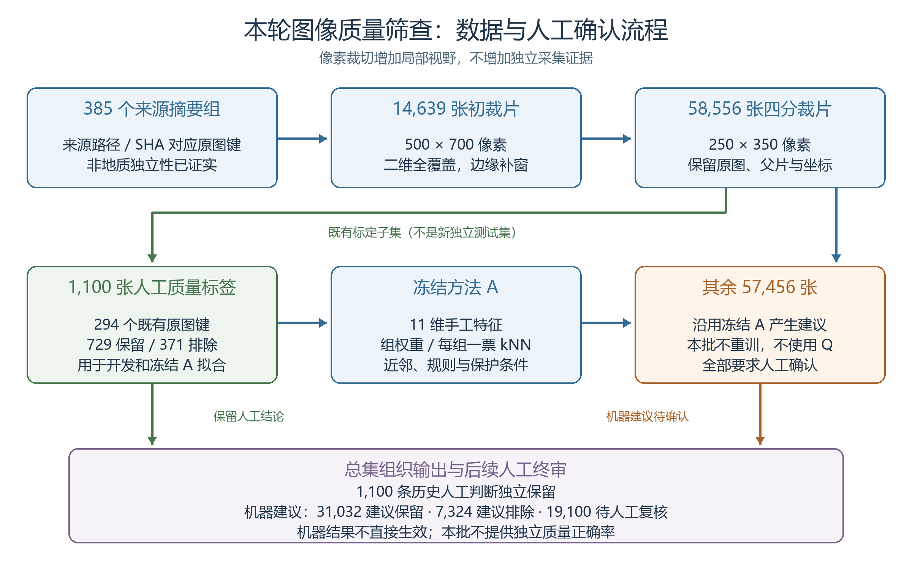
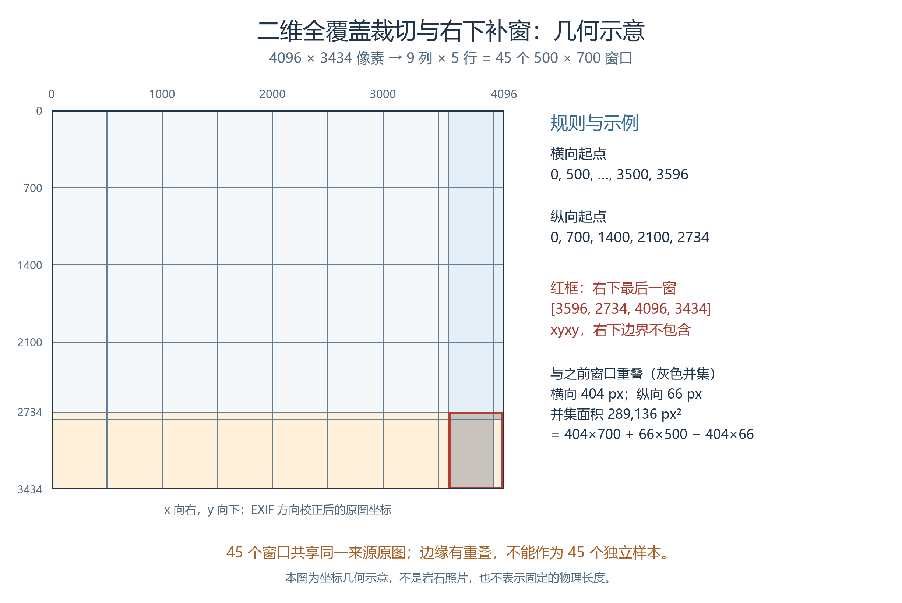
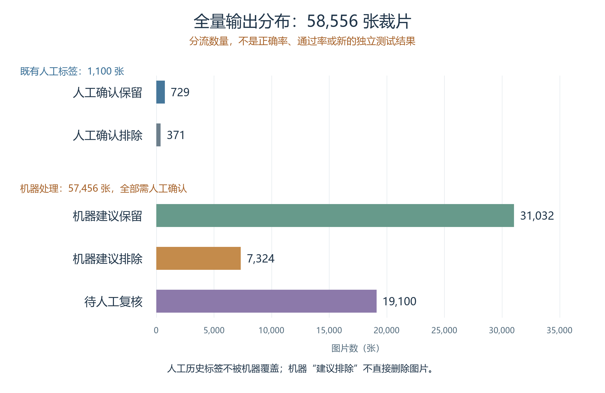

# 岩芯图像质量筛选与岩性分类


同一张岩芯照片裁成小图后，有的裁片能看清纹理，有的已经模糊，还有的岩石本身就缺少明显纹理。项目先判断哪些裁片适合参与分析，再用筛选后的裁片进行岩性分类。我参与了图像筛选和训练数据整理。

## 图解与阅读手册

[阅读《岩芯图像质量筛选：项目汇报与初学者手册》公开阅读版（PDF，13 页）](docs/core-image-quality-guide.pdf) · [直接打开或下载 PDF](https://raw.githubusercontent.com/zhang-zmt/rock-core-image-analysis/main/docs/core-image-quality-guide.pdf)

### 从原图到审核队列



### 裁切窗口怎样覆盖图像边缘

以 4096 × 3434 像素的原图为例，500 × 700 的窗口分为 9 列、5 行。最右列和最下行向图像边缘对齐，重叠区域的坐标写入裁片清单。



### 质量筛选输出

这张图记录人工复核前的状态。1,100 张已有人工标签，其余 57,456 张由筛选器分别给出保留、排除和待复核建议。下表中的最终质量清单记录后续合并结果。



## 项目结果

| 环节 | 已记录的结果 |
| --- | --- |
| 裁切与筛选 | 共生成 58,556 张裁片。最终质量清单保留 41,368 张，排除 17,188 张。 |
| 分类评估 | 在 4,136 张测试裁片上复算已有模型权重，准确率为 97.44%，宏平均 F1 为 95.64%。 |

训练与测试裁片存在原图来源重合。这些指标反映模型在当前同源数据上的表现，跨来源岩芯上的效果仍待验证。

## 使用源码

建议使用 Python 3.10 或以上版本，并在独立环境中运行以下命令。

```sh
python -m pip install -r requirements.txt
python classification/utils/test_split_lithology_crops.py
python preprocessing/core_crop.py --help
python classification/utils/train_best.py --help
python classification/test_new.py --help
```

- `preprocessing/` 提供原图滑窗裁切和四等分程序。使用自己的图片可先运行 `python preprocessing/core_crop.py --input ./images --output ./crops --scan full --dry-run` 查看计划。
- `quality/` 提供图像质量特征、按原图分组的近邻拟合与保留、排除和复核判定。使用自己的人工标注样本拟合。
- `classification/utils/` 包含按岩性划分训练集的脚本、合成样例测试和 ResNet 训练入口。训练输入支持按类别组织的目录或清单。
- `classification/test_new.py` 使用自备的 21 类 ResNet101 权重和相应类别映射进行推理，按审核结论筛选裁片时还需要质量清单。
- `classification/evaluation/evaluate_checkpoint.py` 根据数据划分、类别映射和模型权重复算分类指标。

公开版本仅提供源码、依赖说明和项目概述。实验图像、逐样本清单和训练权重由使用者自行准备。
